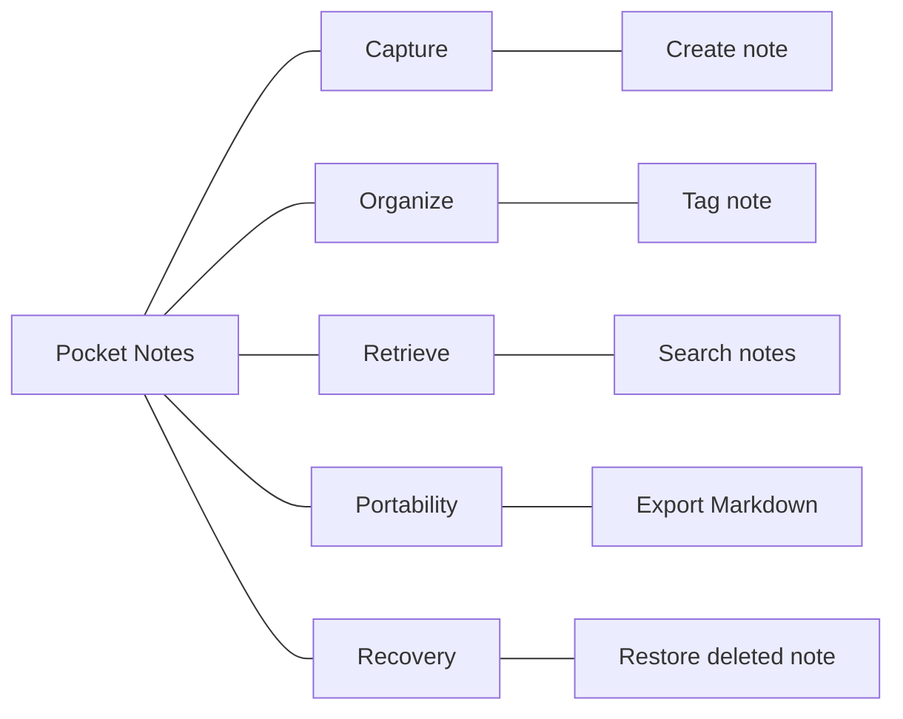

# Connected capability chart

Use this guidance only after choosing a hierarchy chart as an optional supporting view. A chart should help readers understand the grouping or navigate it. Omit it when the map's headings already serve that purpose.

Prefer a Mermaid `flowchart` with explicit edges to show the functional hierarchy. Connect the product root to each area and each area to its features; do not rely on indentation-based `mindmap` connections. Use descriptive internal node identifiers and readable feature names in quoted labels. Link feature names to their stable reference paths in the text fallback. Use `LR` for a horizontal hierarchy or `TB` when it fits the document better.

Include all inventory features by default. For a large map, split into linked area diagrams or explicitly label a selected overview. Every displayed feature must still have a path to the product root. Provide a text tree or nested list as a fallback, either immediately below the diagram or by linking to the document's feature tree.

## Example: Pocket Notes

Text fallback:

- Capture: [Create note](features/create-note.md).
- Organize: [Tag note](features/tag-note.md).
- Retrieve: [Search notes](features/search-notes.md).
- Portability: [Export Markdown](features/export-markdown.md).
- Recovery: [Restore deleted note](features/restore-deleted-note.md).

Keep detailed product behavior in the linked feature references. Plain edges express containment, not execution order or dependencies. Check that node IDs are unique, feature references resolve, and every node is reachable from the product root. If the chart claims complete coverage, compare its feature references with the inventory. Render locally when supported to check layout and visible connections; graph connectivity checks alone do not establish rendering quality. Do not upload private product content to a diagram service for validation.
